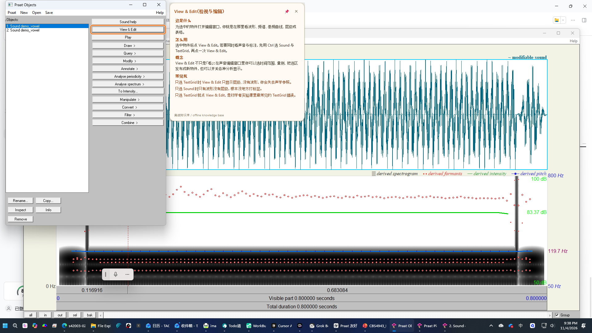
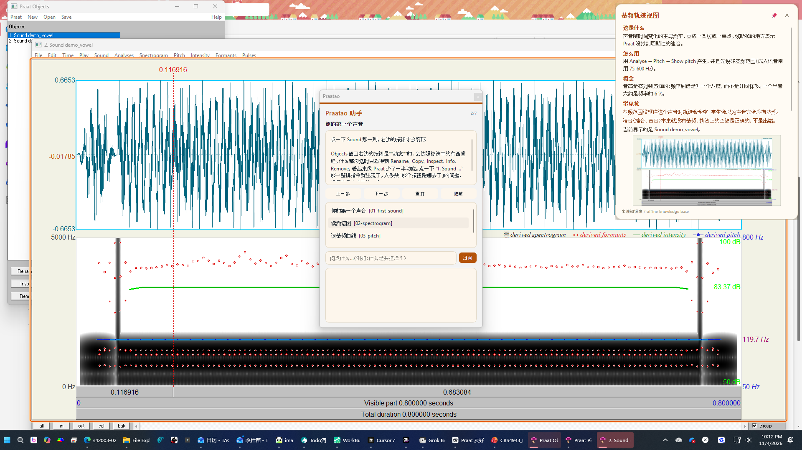
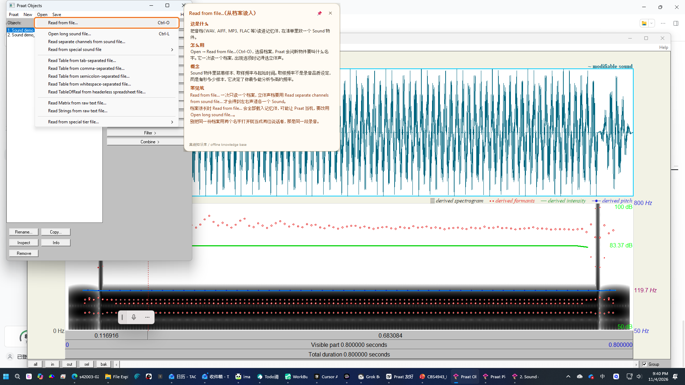
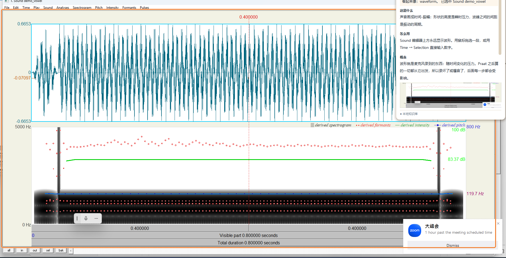
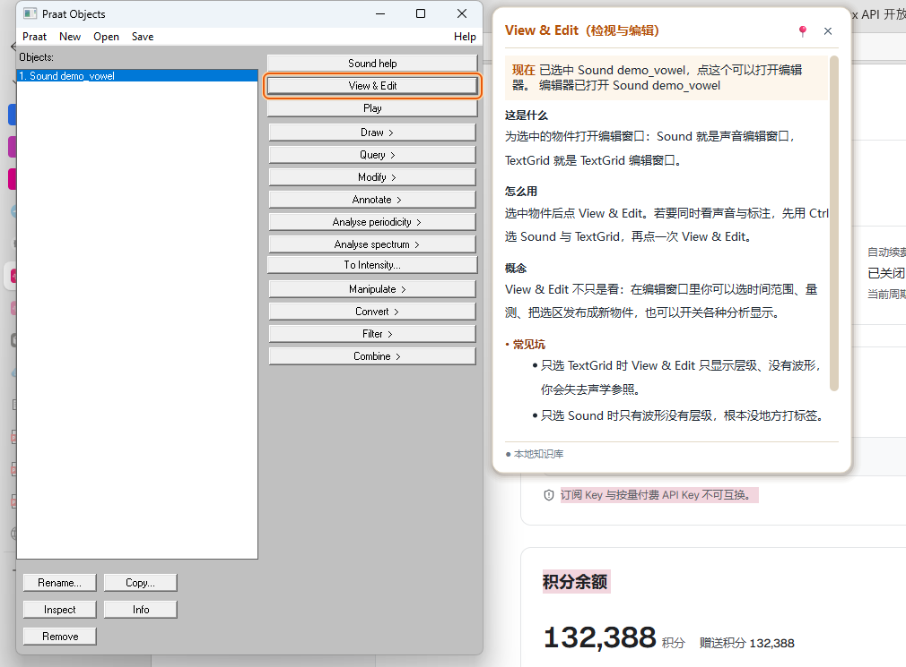
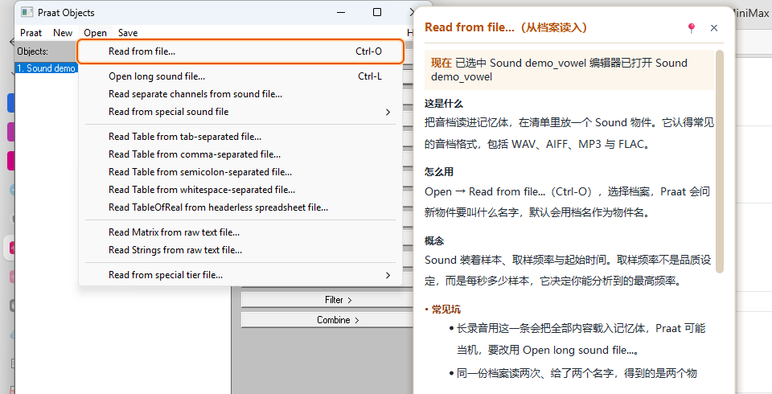
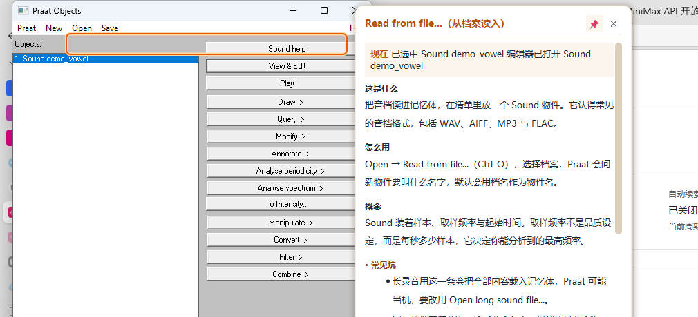
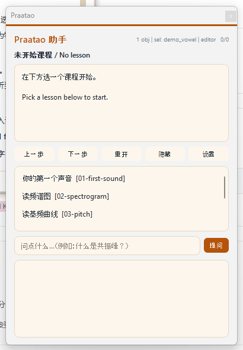
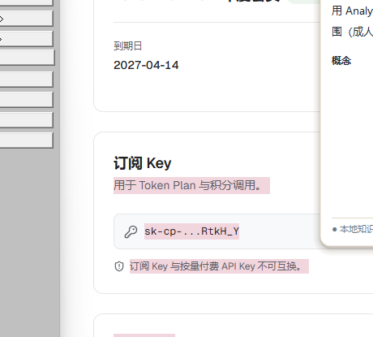
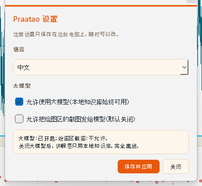

# Praatao

[中文](README.zh.md)

**Praat + Augmentation + Orientation** — a companion overlay that teaches you
Praat while you use it. Point at a button, and a small card tells you what it
does, how to use it, what the underlying phonetic idea is, and where beginners
usually go wrong.



## TL;DR

- **Status:** v1 runnable on Windows, tested against Praat **6.4.12** with
  **288** bilingual knowledge entries and **6** guided lesson packs.
- **Run it:** start Praat (the `Praat.exe` in this folder is fine), then
  ```powershell
  cd D:\Documents\Playground\praatao
  python run.py
  ```
  Hover any button in Praat. `Ctrl+Alt+P` opens the side panel.
- **Closing means leaving.** The X of the greeting window, of the side panel
  and of the settings window all end the coach: the tray icon goes away and
  no process stays behind. Double-clicking the shortcut twice does not start
  a second coach either; the second copy brings the running one forward and
  then leaves.
- **The card scrolls.** When the text is long, the wheel scrolls it and the
  scroll bar can be dragged, and dragging the scroll bar does not make the
  card disappear (only a click on the card itself does).
- **The key finding:** we do **not** need OCR, a vision model, or hard-coded
  screen coordinates. Praat's Windows GUI is drawn by a Motif emulator that
  maps its widgets onto real HWNDs, so Windows UI Automation exposes every
  button **by name and with an exact rectangle** — measured hit test
  **1-5 ms**. See [ADR-004](docs/10-sensing-strategy.md).
- **The drawing areas are in the tree too.** Praat's canvases show up as
  `[PaneControl] 'drawingArea' cls='PraatDrawingArea1 Praat'` with an exact
  rectangle, so the overlay knows *where* the spectrogram is and can look at
  it. (An earlier draft of this file claimed otherwise; it was wrong.)
- **About "Python for Praat":** no such package exists on PyPI (HTTP 404).
  The real one is **Parselmouth**, and it wraps Praat's *algorithms*, not its
  *GUI*, so it cannot answer "what is under the cursor". Full survey:
  [docs/09-python-for-praat.md](docs/09-python-for-praat.md).

## What it does

| | |
|---|---|
| **Hover** | Rest the cursor on any Praat control. After a short dwell, a card explains it: what, how, the concept behind it, and the classic beginner traps. The knowledge base holds **288** bilingual entries: the Objects window, the menus, the editor windows, the everyday workflows and the acoustic concepts. |
| **Context** | The card also uses what your project currently contains: which Sound is selected, whether an editor is open, whether a TextGrid exists yet, and even the duration and sampling rate of the selection. |
| **Drawing areas** | Hover the waveform, spectrogram or pitch view and the card explains *that kind* of picture, shows the picture itself, and (opt-in) lets a model read the axes and the cursor position. |
| **Lessons** | Six guided tours (first sound, spectrogram, pitch, TextGrid, the everyday analysis workflow, batch work and export) that advance themselves as your Praat state changes. |
| **Ask** | A free-text box in the side panel answers questions from the knowledge base, and optionally from an LLM. |
| **AI pictures** | When the knowledge base has nothing to say, an image model can draw a small teaching diagram for the card. |



Hovering a menu item works too, including the keyboard shortcut that Praat
reports for it:



### Fast enough to feel like nothing happens

| | before | after |
|---|---|---|
| Pointer stops to card on screen | 380 ms (worst round 2.6 s) | **312 ms** (worst 346 ms) |
| CPU while idle | 14.8 % | **5.5 %** |
| Longest UI-thread stall | 60.7 ms | **19.1 ms** |
| Knowledge base lookup that misses | 3.87 ms | **0.30 ms** |

Method, before/after tables and the reason for every change:
[docs/15-performance.md](docs/15-performance.md). The measuring tool
(`prototypes/v1/experiments/perf_probe.py`) can put the old implementation
back with `--legacy`, so "before" and "after" come from the same machine in
the same session.

### The card was redesigned after looking at mature tools

The old card mixed three colours and two font weights, and its "common
pitfalls" block was a wall of orange text. It also never answered "why do I
need this right now?". The new card has six layers: title, **Now** (new:
what is happening in Praat at this moment), what it is, how to use it, the
concept, common pitfalls, and a footer. Hierarchy comes from weight and
position, not from colour; the Chinese text uses a proper font stack and no
line is longer than 28 characters; the card never covers the control it
explains. Notes: [docs/16-card-design.md](docs/16-card-design.md), before
and after pictures in `docs/screenshots/card-design/`.

### The card behaves like a tooltip, not like a window

| | |
|---|---|
| **Leave** | The card disappears two seconds after the pointer leaves it. |
| **Click** | A click on the card dismisses it. |
| **Pin** | The pin button keeps it open while you work. |
| **Late answers** | When a model answer arrives seconds later, the card updates itself in place. |

### Acceptance screenshots

Every picture was taken while the **real** application was running its **real**
tick loop, with the **real** mouse on a real Praat control.

| | |
|---|---|
|  |  |
| **Drawing area**: the pointer rests on the spectrogram; the card explains the view and shows the very picture you are looking at. | **Control**: the pointer rests on a button; the card explains what it is, how to use it, the concept behind it, and the traps. |
|  |  |
| **Menu item**: a menu can be explained while it is still open; the shortcut comes for free. | **Pinned**: after the pin, the card no longer disappears on its own. |
|  |  |
| **Side panel**: lesson progress, live state, free questions. | **Model**: the answer lands in the card seconds later, with an illustration. |
|  | |
| **Settings window**: language, model on/off, pictures allowed: all changed here. | |

Reproduce them with `python prototypes/v1/acceptance_capture.py`
(the pictures land in `docs/screenshots/acceptance/`; the ones starting with
`focus-` are the close-ups).

## How it works

```
 mouse  ──►  praatao/sensors/uia.py          what is under the cursor?
 Praat  ──►  praatao/sensors/praat_state.py  what does Praat contain?
             praatao/sensors/canvas.py         what does the picture show?
                    │
                    ▼
            praatao/tutor/                    what should we say?
              kb.py  lessons.py  advisor.py  llm.py
                    │
                    ▼
            praatao/ui/                       how do we say it?
              hover.py  spotlight.py  panel.py         (Tk fallback)
              qt/hover.py qt/panel.py qt/spotlight.py (PySide6)
```

Three layers, deliberately separated:

- **`sensors/`** never imports from `tutor/` or `ui/`.
- **`tutor/`** never imports from `ui/`.
- **`ui/`** receives plain data and knows nothing about Praat.

### Two front-ends, one behaviour

The card was rebuilt with **PySide6**, because the Tk version was
click-through (so that Praat keeps working) and therefore could not have a
pin button. The Qt card is a frameless, translucent, rounded window with a
soft shadow, a title, a pin button, a close button, styled section headings
and room for a picture. The Tk version stays as a fallback and is chosen
automatically when PySide6 is missing (`python run.py --ui tk` forces it).

### Why UI Automation and not a vision model

| Approach | Name of the control | Where it is | Cost | Works offline |
|---|---|---|---|---|
| Hard-coded coordinates | no | drifts with layout | free | yes |
| Screenshot + OCR | error-prone | approximate | low | yes |
| Screenshot + vision model | approximate | approximate | high, slow | no (cloud) |
| **Windows UI Automation** | **exact** | **exact** | **free, 1-5 ms** | **yes** |

UIA also hands us the keyboard shortcuts for free, because Praat puts them in
the menu item's name (`Read from file...\tCtrl-O`).

Where a model still earns its keep: reading the *content* of a
drawing area (the axis labels, the cursor position, the legend).
The rectangle comes from UIA; the interpretation may come from a
model, but only with the user's consent, because a Praat picture
can be a participant's voice.
### What Praat's own scripting is used for

Only for **semantics**, never for geometry. `Praat.exe --send` runs a tiny
probe script that reports the selected objects, their type, and the acoustic
attributes of the selected Sound. Two things the probe deliberately does *not*
do: it never changes your selection, and it never enumerates all objects
(Praat's scripting language has no such function — verified against the
manual and by measurement).

**But the script runs only very rarely, sometimes not at all.**  Measurement
showed that *any* Praat script closes whatever menu the user has open.  So
the hot path (the state refresh every 0.9 s) reads the Objects window
through UI Automation instead: 17 ms for the object list *and* the
selection, and **not a single script is sent**.  Only things that really
need a script (the tier names of a TextGrid) are fetched, and then only
while the user is visibly idle (mouse still, no menu open).

A second thing closes menus: the **UIA hit test**.  One
`ControlFromPoint` over the menu bar and the menu that was open closes
itself (measured).  So while a menu is open the coach does **no** global
hit test at all: it reads the items straight from the popup's own control
tree and picks the one under the pointer.  Resting on a menu item still
gets you an explanation, and the menu stays exactly where it was.

That is what lets Praatao sit in the background quietly: the menu you
opened is never taken away from you.

And a third thing: **Praat must not steal your keyboard.**  Measurement
shows that `Praat.exe --send` activates the Praat window, and so does a
UIA hit test.  The coach therefore follows one hard rule:

> **The coach only touches Praat while Praat is the application in front.**

While you type in another program the coach does not touch Praat at all
(no hit test, no picture grab, no script), so Praat cannot jump forward
and swallow your keystrokes.  The moment you click back into Praat the
coach resumes.

## Quick start

### Every day: double-click "Praatao 助教" on the desktop

The shortcut is already on the desktop (and in the start menu). Double
clicking it

1. starts Praat for you when it is not running yet, and brings it to the
   front (`Praat.exe` sits next to the program),
2. starts the coach **without a console window**,
3. says hello in a small window in the corner that carries three buttons
   (**open the panel / settings / quit**) and fades away by itself,
4. leaves an icon in the system tray, where the panel, the settings and
   the way out live.

A beginner does not have to learn a single hotkey: the buttons on the
greeting are the entry point.

> Cannot find the tray icon? Windows hides it behind the small arrow next
> to the clock.

**The packaged build**: `dist\Praatao\Praatao.exe` is a self-contained
executable that does exactly the above (no console window, Praat next to
it).  Rebuild it with:

```powershell
python tools\packaging\build.py
```

**When there is no window at all**: the banner goes to
`%LOCALAPPDATA%\praatao\coach.log`, which is the first file to look at
when something goes wrong.

The same entry point is the `Start-Praatao.cmd` file in the repository
root, so this works too:

```powershell
cd D:\Documents\Playground\praatao
.\Start-Praatao.cmd              # normal start
.\Start-Praatao.cmd --no-llm     # without the language model
.\Start-Praatao.cmd --lang en    # English interface
```

Should the shortcut ever be missing (new machine, tidied desktop), one
command puts it back:

```powershell
python tools\make_shortcut.py --start-menu
```

### While developing

```powershell
cd D:\Documents\Playground\praatao

# 1. See what the sensors can see (no mouse, no windows)
python run.py --selftest

# 2. Start the coach
python run.py

# 3. Run the tests
python -m unittest discover -s tests

# 4. Check the dictionary and the lesson packs
python tools\check_elements.py
python tools\check_lessons.py

# 5. Merge the knowledge-base fragments into the main file
python tools\merge_elements.py
```

Requires Python 3.12, `pywin32`, `uiautomation` and `PyYAML` (all already
installed on this machine). `Praat.exe` is **not** in this repository (Praat is
GPL): download Praat 6.4.12 from <https://praat.org> and put `Praat.exe` in the
repository root. The Qt front-end additionally needs `PySide6`; without it the
program falls back to the Tk one.

### Keyboard shortcuts (global, they work while Praat has focus)

| | |
|---|---|
| `Ctrl+Alt+P` | show / hide the side panel |
| `Ctrl+Alt+N` | next lesson step |
| `Ctrl+Alt+R` | restart the lesson |
| `Ctrl+Alt+Q` | focus the question box |
| `Ctrl+Alt+S` | **open the Praatao settings window** (language, model on/off, privacy) |
| `Ctrl+Alt+H` | hide every overlay |
| `Ctrl+Alt+X` | **quit the coach** (no hunting for its console window) |
| `F1` | pin / unpin the hover card |
| `Esc` | dismiss the hover card |

### The settings window (`Ctrl+Alt+S`, or the "Settings" button in the panel)

A standalone Praatao window with three switches:

| | |
|---|---|
| **Language** | Chinese / English, applied at once |
| **Use the language model** | with it off the coach only uses the local knowledge base and works completely offline |
| **Allow pictures of the drawing area** | off by default; only with it on can the model ever see your Praat picture |

The settings live in `%LOCALAPPDATA%\praatao\settings.json` and never leave
this computer.  The command line wins over them: `--lang`, `--no-llm`,
`--vision`.

### The model layer

The curated knowledge base is always on and never needs the network: labs
often have none, and a wrong phonetic explanation is worse than none.

On top of that a model can be used for the controls the knowledge base does
**not** cover. Nothing has to be configured on this machine: the program
falls back to the MiniMax credentials of the DeepSeek Harness
(`~/.dsh/.credentials.yaml`), so the model is available out of the box. The
key is never written into the repository and never printed.

```powershell
# any OpenAI-compatible endpoint (DeepSeek, OpenAI, a local Ollama)
$env:PRAATAO_LLM_ENDPOINT = "https://api.deepseek.com/v1"
$env:PRAATAO_LLM_MODEL    = "deepseek-chat"
$env:PRAATAO_LLM_API_KEY  = "sk-..."

# switch everything off
$env:PRAATAO_LLM_OFF = "1"
```

Two extra routes are **opt-in**, because they cost money and because a Praat
picture can be a participant's voice:

```powershell
$env:PRAATAO_VISION   = "1"   # let a model read Praat's drawing areas
$env:PRAATAO_IMAGEGEN = "1"   # let an image model draw a teaching diagram
```

The drawing-area route has a local fallback that always works and never
leaves the machine: a small image analysis says whether the picture looks
like a spectrogram, a waveform or a pitch view, and the knowledge base
explains that kind of view.

## What is in the box

| Path | |
|---|---|
| `praatao/sensors/uia.py` | UI Automation sensor: element tree, hit test, menu enumeration, invoke |
| `praatao/sensors/praat_state.py` | Praat semantic probe (`--send`), object list, modal-dialog recovery |
| `praatao/sensors/canvas.py` | Praat's drawing areas: where they are, what they look like |
| `praatao/tutor/llm.py` | the model client: OpenAI-compatible, Ollama, MiniMax, image generation |
| `praatao/tutor/kb.py` | knowledge base loader and the matching rules |
| `praatao/tutor/lessons.py` | lesson packs and the step engine |
| `praatao/tutor/advisor.py` | state -> advice, context-aware |
| `praatao/ui/` | hover card, spotlight ring, side panel, hotkeys (Tk) |
| `praatao/ui/qt/` | the same pieces, drawn with PySide6 (plus the settings window) |
| `praatao/settings.py` | the student's settings: language, model on/off, privacy |
| `praatao/content/elements.yaml` + `praatao/content/elements/` | **bilingual UI-element entries** (main file plus fragments) |
| `praatao/content/lessons/` | lesson packs + index (first steps, analysis workflow, batch work and export) |
| `run.py` | entry point |
| `docs/` | research notes, ADRs, interface contracts |
| `prototypes/v0/`, `prototypes/v1/` | the earlier prototype and the measurement scripts |

## Honest limits

- **Windows only.** UIA is a Windows technology; macOS/Linux would need a
  different sensing path.
- **A drawing area is not a control.** UIA gives the exact rectangle of
  Praat's canvases, but not their content. What is inside the picture is
  either guessed locally (cheap, offline, rough) or read by a model (exact,
  but opt-in and not offline). The pointer picks the row: Praat draws the
  waveform in blue-green, the formants as red dots and the pitch curve in
  blue, so the row under the pointer says what that row is.
- **A disabled button is reported by UIA as its unnamed container.** The
  sensor works around this with a geometric fallback, but it costs a tree
  walk, so the first hover over a disabled control can take ~80 ms.
- **A failing Praat script pops a modal box that hides the dynamic button
  row.** The probe clears such boxes automatically after a timeout, but the
  student should see the error message before it disappears.
- **Praat closes an open menu as soon as a script runs.** The state refresh
  therefore uses UI Automation rather than a script, and a script is only
  sent now and then while the user is visibly idle (see above). A submenu
  counts as well: it is owned by the menu above it, so the owner chain is
  walked when the coach looks for a Praat menu.
- **UI strings are Praat 6.4.12.** Newer Praat versions rename things (the
  content pack carries both old and new spellings for the known cases).
- **Praat must not steal your keyboard.** The coach only touches Praat while
  Praat is the application in front, so Praat cannot jump forward while you
  are typing in another program.
- **No help while Praat is in the background.** For the same reason the card
  takes itself away when you go back to another program. The test is "does the
  foreground window belong to Praat.exe", not the window title (another
  program may well be called "Praat something").
- **The controls inside a modal dialog are recognised too.** When a dialog
  (Praat's "Formant settings", for instance) sits on top of the picture, the
  coach explains the control under the pointer and what the dialog is for,
  not the waveform behind it.
- **The knowledge base only says what it checked.** All 288 entries were
  written against a real Praat 6.4.12; when it has nothing, the coach stays
  quiet instead of guessing.

## Documentation

| | |
|---|---|
| [docs/00-concept.md](docs/00-concept.md) | what Praatao is |
| [docs/architecture-board.html](docs/architecture-board.html) | **the architecture board**: one page that shows how the data flows (open it in a browser) |
| [docs/09-python-for-praat.md](docs/09-python-for-praat.md) | the package survey — does "Python for Praat" exist? |
| [docs/10-sensing-strategy.md](docs/10-sensing-strategy.md) | **ADR-004** — UIA vs coordinates vs vision, with measurements |
| [docs/12-architecture-v1.md](docs/12-architecture-v1.md) | the v1 architecture, module by module |
| [docs/13-content-guide.md](docs/13-content-guide.md) | how to write knowledge entries and lessons |
| [docs/15-performance.md](docs/15-performance.md) | **performance**: before and after, measured (latency, CPU, stalls) |
| [docs/16-card-design.md](docs/16-card-design.md) | **the card's design**: what was wrong, what mature tools do, what changed |
| [docs/17-parselmouth-checks.md](docs/17-parselmouth-checks.md) | **checking the numbers**: every figure in the knowledge base, recomputed with Parselmouth |
| [docs/CONTRACTS.md](docs/CONTRACTS.md) | module interfaces + the verified Praat scripting API |
| [docs/README.md](docs/README.md) | full index |

## Credits

Praat is by Paul Boersma and David Weenink. The UI Automation measurements
in `docs/10-sensing-strategy.md` were taken on this machine against Praat
6.4.12. Content: `praatao/content/`.
