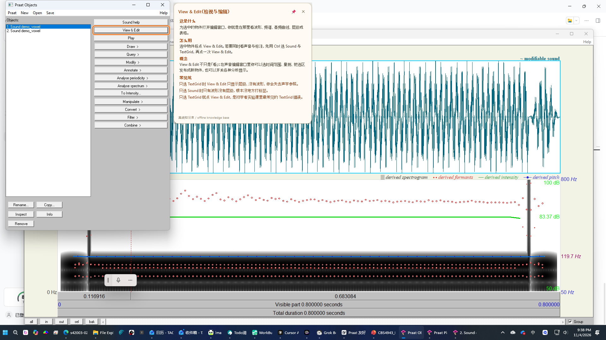
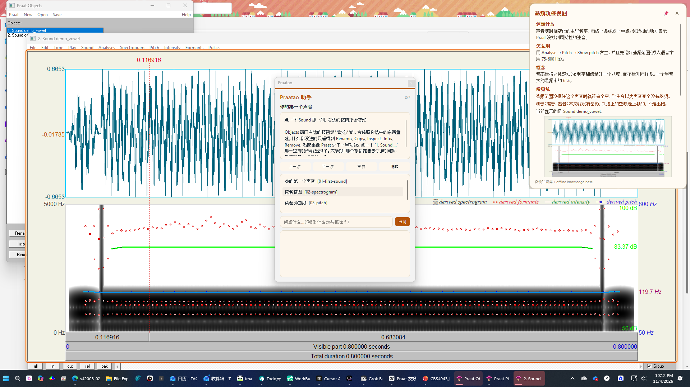
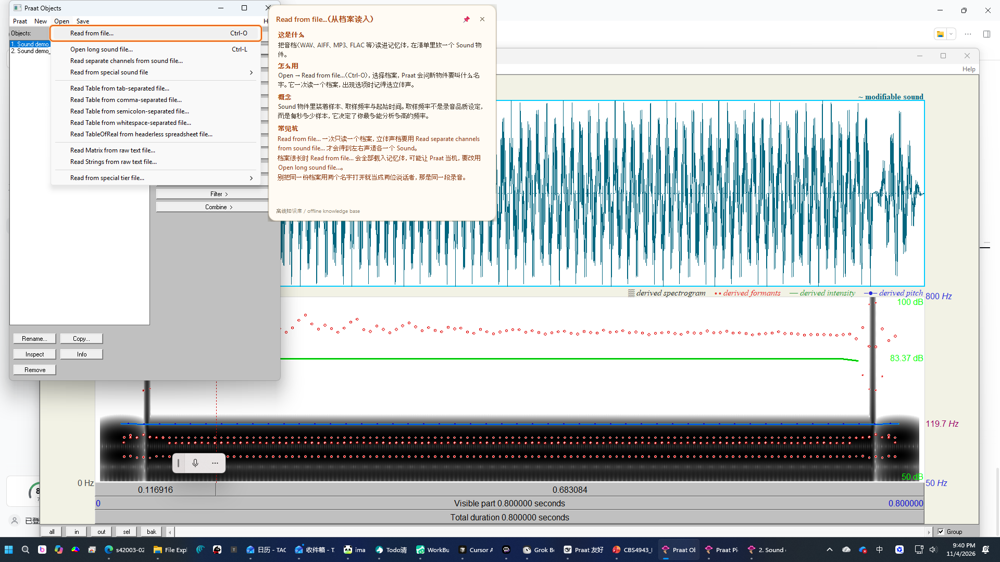
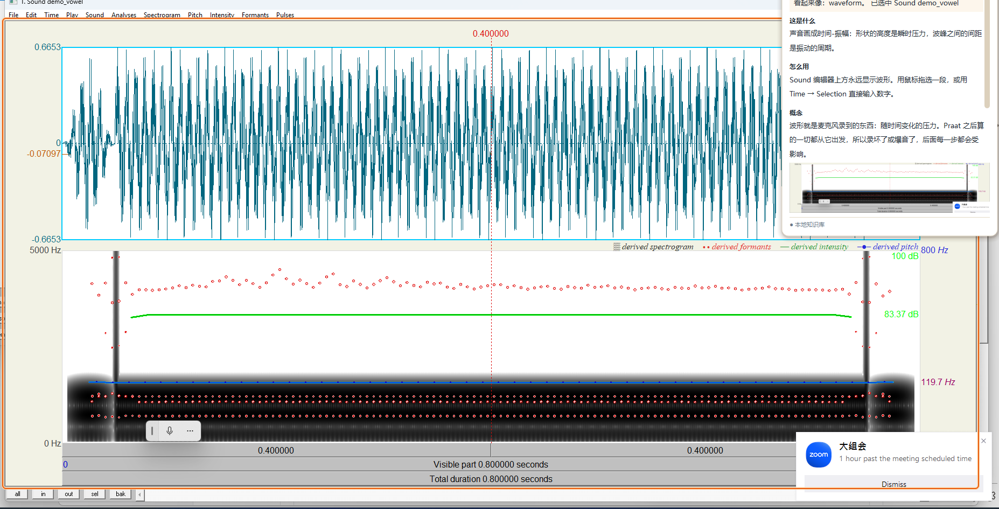
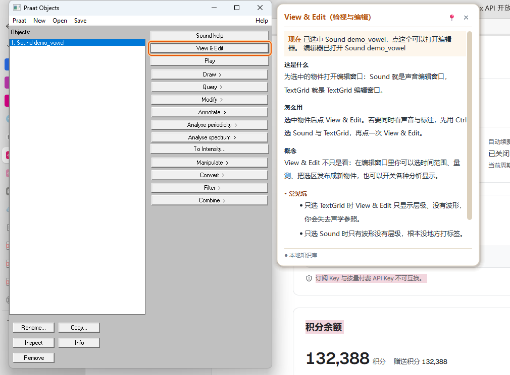
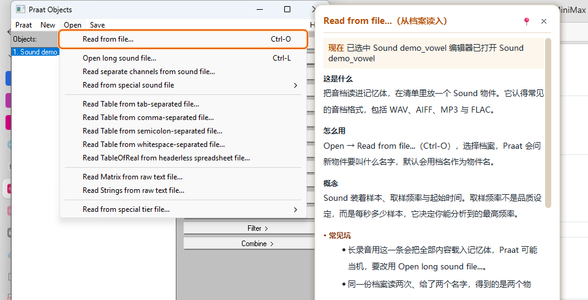
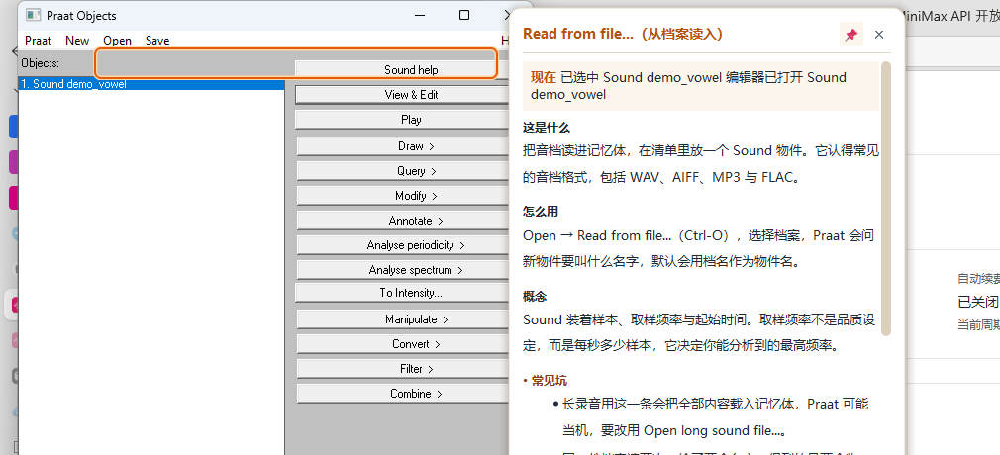
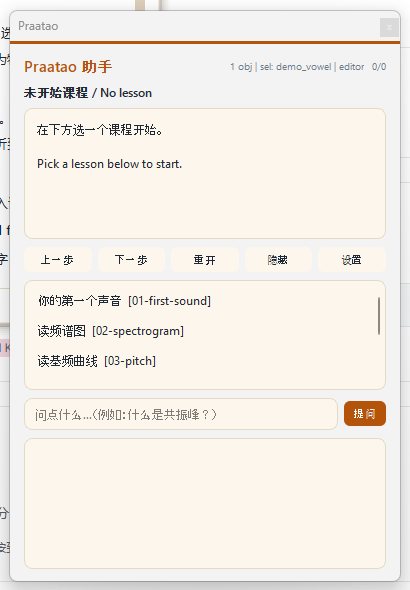
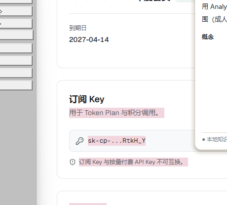
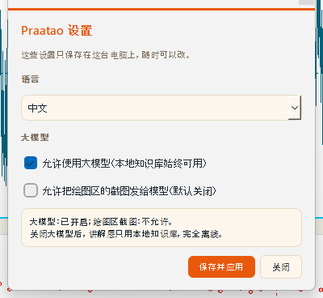

# Praatao

[English](README.md)

**Praat + Augmentation + Orientation** —— 一个陪在 Praat 旁边的讲解层。
你把鼠标停在某个按钮上，它就告诉你：这个按钮是干什么的、怎么用、
背后的声学概念是什么、初学者最容易在哪里栽跟头。



## 一句话总结

- **状态：** v1 可以在 Windows 上跑，已针对 **Praat 6.4.12** 实测通过；
  内置 **288** 条中英双语知识条目、**6** 个引导式课程包。
- **最省事的用法：下载即用。** 到
  [**Releases**](https://github.com/neurosciencetao/praatao/releases) 下载
  `Praatao-v1.0.0-windows-x64.zip`（约 65 MB），解压到任意文件夹，双击里面的
  **「启动 Praatao.cmd」**（或 `Praatao.exe`）就能用：**不用装 Python，不用装
  Praat**，zip 里自带 Praat 6.4.12。
- **谁做的：** 想法是**陶老师**（香港理工大学语言科学与技术学系）出的，
  实现是 **DeepSeek Harness（DSH）里的编程助手**做的，跑在 **MiniMax-M3.1-Flash**
  模型上：感知、卡片、课程、性能优化、打包、看板、289 个测试，都是这个助手在
  这台机器上一行一行写出来、并且逐条实测过的。想法、验收标准和取舍由陶老师定。
- **跑起来（源码版）：**
  ```powershell
  cd D:\Documents\Playground\praatao
  python run.py
  ```
  然后把鼠标停在 Praat 的任何按钮上。`Ctrl+Alt+P` 打开侧栏。
- **关掉就是退出：** 欢迎窗、侧栏、设置窗口，**任何一个的 X 都要掉**，
  整个讲解层就退出了（托盘图标也一起消失），后台不留进程。
  重复双击快捷方式也**不会**开出第二个讲解层：第二个会把已经在跑的那个叫到
  前面来，然后自己走掉。
- **卡片能滚。** 内容长了的时候，鼠标滚轮可以往下读，右侧的滚动条也可以拖；
  拖滚动条**不会**让卡片消失（点卡片本身才会收起）。
- **关键发现：** 我们**不需要** OCR、不需要视觉模型、也**不需要**硬编码坐标。
  Praat 的 Windows 界面是用 Motif 模拟层画出来的，控件都落在真正的 HWND 上，
  所以 Windows UI Automation 能**按名字**、**带精确矩形**地把每个按钮交出来，
  实测命中测试 **1-5 毫秒**。详见 [ADR-004](docs/10-sensing-strategy.md)。
- **绘图区其实也在树里。** Praat 的画布会以
  `[PaneControl] 'drawingArea' cls='PraatDrawingArea1 Praat'` 出现，
  带着精确矩形，所以讲解层知道频谱图**在哪里**，也能看它。
  （这份文件早前的版本说「看不见」，那是错的。）
- **关于「Python for Praat」：** PyPI 上根本没有这个包（HTTP 404）。
  真正存在的是 **Parselmouth**，但它包装的是 Praat 的**算法**，不是它的
  **界面**，所以它没法回答「鼠标底下是什么」。完整调研见
  [docs/09-python-for-praat.md](docs/09-python-for-praat.md)。

## 它能做什么

| | |
|---|---|
| **悬停讲解** | 鼠标停在任何控件上，停留片刻后弹出一张小卡片：这是什么、怎么用、背后的概念、常见坑。知识库有 **288** 条中英双语条目，覆盖 Objects 窗口、菜单列、编辑窗口、常见工作流与声学概念。 |
| **结合当前项目** | 卡片还会看你现在项目里有什么：选中了哪个 Sound、编辑器有没有开、有没有 TextGrid，连选中物件的时长与采样率也一起交给模型。 |
| **看懂绘图区** | 鼠标停在波形、频谱图、基频曲线上，卡片会解释**这类图**、把图本身贴给你看，（可选）还让模型读出坐标轴和游标位置。 |
| **课程引导** | 六个引导式课程（第一个声音、看频谱图、看基频、做 TextGrid、日常分析流程、批量处理与导出），会跟着你的 Praat 状态自动前进。 |
| **自由提问** | 侧栏的提问框可以从知识库里回答，也可以（可选）调用大模型。 |
| **AI 配图** | 知识库答不上来的时候，可以让生图模型画一张示意图放进卡片。 |
| **报告问题** | 侧栏底部和托盘里都有「报告问题」。写清楚发生了什么，可以留邮箱；按下之后会打开 GitHub 的新问题页面，内容**已经填好**，你看过、愿意发再发。一份副本也会存在自己电脑上（`%LOCALAPPDATA%\praatao\feedback`）。 |



菜单项也能悬停讲解，而且快捷键是**免费附送**的，因为 Praat 把它写在了菜单项的名字里
（`Read from file...\tCtrl-O`）：



### 快到感觉不到它在工作

| | 改之前 | 改之后 |
|---|---|---|
| 指针停住到卡片上屏 | 380 ms（最坏一轮 2.6 秒） | **312 ms**（最坏 346 ms） |
| 空闲时的 CPU | 14.8 % | **5.5 %** |
| 界面线程单次卡顿 | 最长 60.7 ms | **最长 19.1 ms** |
| 知识库查不到时的扫描 | 3.87 ms | **0.30 ms** |

方法、前后对照与每处改动的理由在 [docs/15-performance.md](docs/15-performance.md)，
测量工具是 `prototypes/v1/experiments/perf_probe.py`（同一个工具可以用 `--legacy`
把改造前的版本装回去再测一遍，所以「改前」和「改后」是同机同时段的数）。

### 卡片的样子是照着成熟工具重做的

旧卡片三种颜色、两种字重混在一起，「常见坑」是一堵橙色的墙，也没有回答
「我现在为什么需要知道它」。重做之后分六层：标题、**现在**（新增，放此刻的
现场信息）、这是什么、怎么用、概念、常见坑、页脚；层次靠字重和位置，不用颜色；
中文字体栈以微软雅黑 UI 开头，一行不超过 28 个汉字；卡片永远不盖住它解释的控件。
笔记在 [docs/16-card-design.md](docs/16-card-design.md)，前后对照图在
`docs/screenshots/card-design/`。

### 卡片的行为像提示气泡，不像窗口

| | |
|---|---|
| **移开** | 鼠标离开两秒后，卡片自动消失。 |
| **点击** | 点一下卡片就关掉它。 |
| **固定** | 固定按钮（📌）让它留在屏幕上不消失。 |
| **迟到的答案** | 大模型几秒后才回的答案，会就地填进卡片。 |

### 验收截图

每一张都是**真实运行**时拍的：真的鼠标、真的 tick 循环、真的 Praat。

| | |
|---|---|
|  |  |
| **绘图区**：鼠标停在频谱图上，卡片解释这类图，并把图本身贴给你。 | **控件**：鼠标停在按钮上，卡片解释这是什么、怎么用、概念、常见坑。 |
|  |  |
| **菜单项**：菜单开着的时候也能讲解，快捷键是白送的。 | **固定**：点 📌 之后卡片不再自动消失。 |
|  |  |
| **侧栏**：课程进度、当前状态、自由提问。 | **大模型**：几秒后答案落进卡片，还能配一张示意图。 |
|  | |
| **设置窗口**：语言、是否用大模型、是否允许发截图，都在这里改。 | |

复现命令：`python prototypes/v1/acceptance_capture.py`
（图片存在 `docs/screenshots/acceptance/`，`focus-` 开头的是裁剪过的特写）。

## 它是怎么工作的

```
 鼠标  ──►  praatao/sensors/uia.py          光标底下是什么？
 Praat ──►  praatao/sensors/praat_state.py  Praat 里装了什么？
           praatao/sensors/canvas.py         这张图画的是什么？
                    │
                    ▼
            praatao/tutor/                   我们该说什么？
              kb.py  lessons.py  advisor.py  llm.py
                    │
                    ▼
            praatao/ui/                      怎么呈现？
              hover.py  spotlight.py  panel.py         （Tk 兜底）
              qt/hover.py qt/panel.py qt/spotlight.py （PySide6）
```

三层，刻意分开：`sensors/` 不 import `tutor/` 或 `ui/`；`tutor/` 不 import `ui/`；
`ui/` 只接收纯数据，完全不知道 Praat 的存在。

### 两套界面，一套行为

卡片用 **PySide6** 重写了一遍。原因是 Tk 版是**点击穿透**的（不然 Praat 就点不动了），
所以它没法有「固定」按钮。Qt 版是一个无边框、半透明、圆角、带柔和阴影的窗口，
有标题、固定按钮、关闭按钮、分节小标题，还能放图。Tk 版留作兜底，
没装 PySide6 时自动退回（`python run.py --ui tk` 可以强制）。

### 为什么用 UI Automation，而不是视觉模型

| 做法 | 控件名字 | 控件位置 | 成本 | 离线可用 |
|---|---|---|---|---|
| 硬编码坐标 | 拿不到 | 会随版面漂移 | 免费 | 是 |
| 截图 + OCR | 会认错 | 只能大致 | 低 | 是 |
| 截图 + 视觉模型 | 只能大概 | 只能大概 | 高、慢 | 否（要上云） |
| **Windows UI Automation** | **精确** | **精确** | **免费，1-5 ms** | **是** |

UIA 还顺手给了键盘快捷键（Praat 把快捷键写在菜单项名字里）。

模型仍然有它的用武之地：**读懂绘图区里的内容**（坐标轴标签、游标位置、图例）。
矩形由 UIA 给，解读可以交给模型，但必须征得使用者同意，因为一张 Praat 图
可能就是受试者的声音。

### Praat 自己的脚本用来做什么

只用来拿**语义**，绝不拿来算几何。`Praat.exe --send` 跑一个很小的探针脚本，
报告当前选中了什么、类型是什么、选中 Sound 的声学属性。探针刻意**不做**两件事：
不改你的选择，也不枚举全部对象（Praat 脚本语言里根本没有这个函数，
官方手册与实测都确认过）。

**但是脚本只在极少数时候跑，甚至不跑。** 原因是实测发现：Praat 一执行脚本，
**用户打开的菜单就会当场消失**。所以热路径（每次 0.9 秒的状态刷新）
改用 UI Automation 读 Objects 窗口，17 毫秒就能拿到对象列表和选中项，
**一个脚本都不发**。只有 TextGrid 的层名这类非用脚本不可的信息，
才在用户明显空闲（鼠标不动、没有菜单、也没有卡片在读）时才偶尔跑一次，
而且在脚本真正发出去之前还会再看一眼有没有菜单开着。

二级菜单也算数：二级菜单的「主人」是上面那一层菜单，不是 Praat 的窗口，
所以判断时会把主人链往上走一层，这样二级菜单同样会被认出来。

还有第二个会关菜单的东西：**UIA 命中测试**。在菜单栏上做一次
`ControlFromPoint`，那个正开着的菜单就会自己关掉（实测）。所以菜单开着的时候，
讲解层**不做全局命中测试**，而是直接从弹出菜单自己的控件树里读菜单项，
再按鼠标位置挑出那一个。用户把鼠标停在菜单项上，照样能得到解释，
菜单却稳稳地留在那里。

这就是为什么 Praatao 可以安安静静地待在后台：你打开的菜单不会被它抢走。

还有第三件事：**Praat 不能抢你的键盘**。实测 `Praat.exe --send` 会把 Praat
窗口激活，而 UIA 命中测试也会。所以讲解层有一条硬规则：

> **只有当 Praat 是前台应用时，讲解层才会去碰 Praat。**

你在别的程序里打字时，讲解层完全不动 Praat（不命中测试、不抓图、
不发脚本），Praat 也就不会跳到前面来抢你的键盘。等你点回 Praat，
讲解层立刻恢复。

## 快速上手

### 给别人用：下载 zip，双击就行

1. 到 [**Releases**](https://github.com/neurosciencetao/praatao/releases) 下载
   `Praatao-v1.0.0-windows-x64.zip`（约 65 MB）；
2. 解压到任意文件夹（例如 `D:\Apps\Praatao`）；
3. 双击里面的 **「启动 Praatao.cmd」**（或 `Praatao.exe`）。

不需要装 Python，也不需要自己装 Praat：zip 里已经带了 Praat 6.4.12。
启动以后：

1. Praat 没开的话，**自动把 Praat 拉起来**（用的是自带的 `Praat.exe`）；
2. 讲解层**不弹命令行窗口**；
3. 屏幕右下角出现一句欢迎语，上面三个按钮：**打开侧栏 / 设置 / 退出**
   （十二秒后自己消失）；
4. 系统托盘里有一个橙色 P 图标，侧栏、设置、退出都在里面。

> 找不到托盘图标？Windows 把它收在任务栏右下角的小箭头里，点开就看到了。

想给桌面建个快捷方式，可以在这个文件夹里跑一次：

```powershell
python ..\tools\make_shortcut.py --start-menu
```

（这步需要 Python，只是方便一点；不建也能用。）

### 自己机器上的日常：双击桌面上的「Praatao 助教」

桌面上已经放好了一个快捷方式（开始菜单里也有一份）。**双击它**就会：

1. 发现 Praat 没开的话，**自动把 Praat 拉起来并置前**（自带 `Praat.exe`）；
2. 启动讲解层，**不弹命令行窗口**；
3. 在屏幕右下角显示一句欢迎语，欢迎语上有三个按钮：**打开侧栏 / 设置 / 退出**（十二秒后自己消失）；
4. 在系统托盘放一个图标，侧栏、设置、退出都在里面。

初学者不需要记快捷键：欢迎语上的按钮就是入口。

> 找不到托盘图标？Windows 把它收在任务栏右下角的小箭头里，点开就看到了。

**打包好的版本**：`dist\Praatao\Praatao.exe` 是一个自带的可执行文件，
双击它就是上面这套流程（没有命令行窗口，Praat 在它旁边）。
重新打包：

```powershell
python tools\packaging\build.py
```

**没有窗口时留下记录**：控制台不出现的时候，开机信息会写进
`%LOCALAPPDATA%\praatao\coach.log`，出错时先看这个文件。

不想用快捷方式的话，仓库根目录的 `Start-Praatao.cmd` 就是同一个入口，
也可以直接跑：

```powershell
cd D:\Documents\Playground\praatao
.\Start-Praatao.cmd              # 正常启动
.\Start-Praatao.cmd --no-llm     # 不连大模型
.\Start-Praatao.cmd --lang en    # 英文界面
```

快捷方式如果不见了（换了机器、清理过桌面），一条命令就能重建：

```powershell
python tools\make_shortcut.py --start-menu
```

### 开发时的用法

```powershell
cd D:\Documents\Playground\praatao

# 1. 看看传感器现在能看到什么（不用鼠标、不弹窗）
python run.py --selftest

# 2. 启动讲解层
python run.py

# 3. 跑测试
python -m unittest discover -s tests

# 4. 检查知识库与课程包（内容改完跑一下）
python tools\check_elements.py
python tools\check_lessons.py

# 5. 把知识库分片合并回主档案
python tools\merge_elements.py
```

需要 Python 3.12、`pywin32`、`uiautomation`、`PyYAML`（这台机器上都已装好）。
`Praat.exe` 不在这个仓库里（Praat 是 GPL 软件）：从 <https://praat.org> 下载
Praat 6.4.12，把 `Praat.exe` 放在仓库根目录即可。Qt 界面另需 `PySide6`，没装就
自动退回 Tk 版。

### 快捷键（全局，Praat 获得焦点时也有效）

| | |
|---|---|
| `Ctrl+Alt+P` | 显示 / 隐藏侧栏 |
| `Ctrl+Alt+N` | 下一步 |
| `Ctrl+Alt+R` | 重开课程 |
| `Ctrl+Alt+Q` | 定位到提问框 |
| `Ctrl+Alt+S` | **打开 Praatao 设置窗口**（语言、是否用大模型、隐私开关） |
| `Ctrl+Alt+H` | 隐藏所有浮层 |
| `Ctrl+Alt+X` | **退出讲解层**（不用去找它的命令行窗口） |
| `F1` | 固定 / 取消固定悬浮卡 |
| `Esc` | 关掉悬浮卡 |

### 设置窗口（`Ctrl+Alt+S`，或侧栏里的「设置」）

一个单独的 Praatao 窗口，三个开关：

| | |
|---|---|
| **语言** | 中文 / English，改完立刻生效 |
| **是否使用大模型** | 关掉之后讲解层只用本地知识库，完全离线 |
| **是否允许发送绘图区截图** | 默认关闭；打开后模型才可能看到你的 Praat 图 |

设置存在 `%LOCALAPPDATA%\praatao\settings.json`，只留在这台电脑上。
命令行参数优先级更高：`--lang`、`--no-llm`、`--vision`。

### 大模型层

人工整理的知识库**一直都在**、也**永远不需要网络**：实验室常常没网，
而且一个错误的声学解释比没有解释更糟。

知识库**没覆盖**的控件，可以再问模型。这台机器上**什么都不用配**：
程序会回退去读 DeepSeek Harness 的 MiniMax 凭据
（`~/.dsh/.credentials.yaml`），所以模型开箱可用。密钥不会写进仓库，
也永远不会打印出来。

```powershell
# 接任何 OpenAI 兼容接口（DeepSeek、OpenAI、本地 Ollama 都可以）
$env:PRAATAO_LLM_ENDPOINT = "https://api.deepseek.com/v1"
$env:PRAATAO_LLM_MODEL    = "deepseek-chat"
$env:PRAATAO_LLM_API_KEY  = "sk-..."

# 全部关掉
$env:PRAATAO_LLM_OFF = "1"
```

另外两条路是**默认关闭**的，因为要花钱，而且一张 Praat 图可能就是受试者的声音：

```powershell
$env:PRAATAO_VISION   = "1"   # 让模型读 Praat 的绘图区
$env:PRAATAO_IMAGEGEN = "1"   # 让生图模型画一张教学示意图
```

绘图区这条路有一条**本地兜底**，永远可用、绝不出机器：本地做一次简单的图像
统计，判断这张图像频谱图、波形还是基频曲线，再由知识库解释这类图。

## 目录里有什么

| 路径 | |
|---|---|
| `praatao/sensors/uia.py` | UI Automation 传感器：元素树、命中测试、菜单枚举、点击 |
| `praatao/sensors/praat_state.py` | Praat 语义探针（`--send`）、对象列表、模态框自愈 |
| `praatao/sensors/canvas.py` | Praat 绘图区：在哪里、画面上画的是什么 |
| `praatao/tutor/kb.py` | 知识库加载与匹配规则 |
| `praatao/tutor/lessons.py` | 课程包与步骤引擎 |
| `praatao/tutor/advisor.py` | 状态 → 建议，带上下文 |
| `praatao/tutor/llm.py` | 模型客户端：OpenAI 兼容、Ollama、MiniMax、生图 |
| `praatao/ui/` | 悬浮卡、高亮光环、侧栏、快捷键（Tk） |
| `praatao/ui/qt/` | 同样几件东西，用 PySide6 画（含设置窗口） |
| `praatao/settings.py` | 学生的设置：语言、是否用大模型、隐私开关 |
| `praatao/content/elements.yaml` + `praatao/content/elements/` | **中英双语 UI 元素条目**（主文件 + 分片目录） |
| `praatao/content/lessons/` | 课程包 + 索引（覆盖入门、分析流程、批量与导出） |
| `run.py` | 入口 |
| `docs/` | 调研笔记、ADR、接口契约 |
| `prototypes/v0/`、`prototypes/v1/` | 早期原型与各种实测脚本 |

## 老实说的局限

- **只有 Windows。** UIA 是 Windows 技术；macOS/Linux 要换一条感知路径。
- **绘图区不是控件。** UIA 能给出 Praat 画布的精确矩形，但给不了里面的内容。
  画面里有什么，要么本地猜（便宜、离线、粗糙），要么交给模型读（准，但要开权限、
  而且不能离线）。指针落在哪一行，就讲哪一行：Praat 把波形画成蓝绿色、
  共振峰画成红点、基频画成蓝色，所以指针停在哪一行，就能认出那一行是什么。
- **被禁用的按钮，UIA 报的是它那个无名容器。** 传感器用几何兜底解决了，
  但代价是要走一次元素树，所以第一次悬停到禁用控件可能要 ~80 毫秒。
- **Praat 脚本报错会弹模态框，并且挡住那排动态按钮。** 探针在超时后会自动
  清掉它，但**学生应该先看到错误内容**。
- **Praat 一执行脚本，打开的菜单就没了。** 所以状态刷新走 UI Automation 而不是脚本，
  脚本只在用户明显空闲时才偶尔跑一次（见上一节）。
- **界面文字按 Praat 6.4.12 校准。** 新版本会改名字（已知变动的内容包里
  新旧两种写法都收了）。
- **Praat 不能抢你的键盘。** 讲解层只在 Praat 是前台应用时才碰它，
  所以你在别的程序里打字时，Praat 不会跳到前面来。
- **Praat 在后台的时候不打扰你。** 同样地，你在别的程序里做事时，卡片会自己
  收起来。判断依据是「前台窗口属不属于 Praat.exe」，不看标题（别的程序也可能
  叫「Praat 什么」）。
- **对话框里的控件现在也认得了。** 模态对话框（例如「Formant settings」）
  压在图画上面时，讲解的是对话框里的那个控件，以及这个对话框是干什么的，
  而不是背后的波形。
- **知识库只讲得准它查得到的东西。** 288 条条目都是对着真的 Praat 6.4.12
  核对过的标签；查不到的时候，讲解层宁可不出声，也不猜。
- **知识库里的数字也核对过。** 用 Parselmouth（Praat 自己的 C/C++ 程式码）把
  75 Hz、2e-5 Pa、每 1000 Hz 一个共振峰这些说法逐条重算，抓出 8 条写错的并改好，
  见 [docs/17-parselmouth-checks.md](docs/17-parselmouth-checks.md)。

## 文档

| | |
|---|---|
| [docs/00-concept.md](docs/00-concept.md) | Praatao 是什么 |
| [docs/architecture-board.html](docs/architecture-board.html) | **架构看板**：一张图看懂数据怎么流动（浏览器直接打开） |
| [docs/09-python-for-praat.md](docs/09-python-for-praat.md) | 包调研：「Python for Praat」到底有没有 |
| [docs/10-sensing-strategy.md](docs/10-sensing-strategy.md) | **ADR-004**：UIA / 坐标 / 视觉，带实测数据 |
| [docs/12-architecture-v1.md](docs/12-architecture-v1.md) | v1 架构，逐模块说明 |
| [docs/13-content-guide.md](docs/13-content-guide.md) | 怎么写知识条目与课程 |
| [docs/15-performance.md](docs/15-performance.md) | **性能**：改之前与改之后的实测对照（延迟、CPU、卡顿） |
| [docs/16-card-design.md](docs/16-card-design.md) | **卡片设计**：旧版的问题、成熟工具的做法、这次的改法 |
| [docs/17-parselmouth-checks.md](docs/17-parselmouth-checks.md) | **数字核对**：用 Parselmouth 把知识库里的每个数字重算一遍 |
| [docs/CONTRACTS.md](docs/CONTRACTS.md) | 模块接口 + 实测过的 Praat 脚本 API |
| [docs/README.md](docs/README.md) | 完整索引 |

## 致谢与分工

- **想法、验收标准、取舍：陶老师**（香港理工大学语言科学与技术学系）。
  需求是他提的，例如「悬停就讲解」「中英双语」「离线可用」「关掉就要真的退出」，
  每一个 bug 都是他实际用的时候发现的。
- **实现：DeepSeek Harness（DSH）里的编程助手**，跑在 **MiniMax-M3.1-Flash**
  模型上。它在这台机器上完成了全部代码：Windows UI Automation 感知层、
  六层讲解卡片、288 条双语知识库与 6 个课程包、MiniMax 兜底问答、性能优化
  （悬停到出卡片 312 毫秒、空闲 CPU 5.5 %）、PyInstaller 打包、架构看板、
  以及 289 个自动化测试与几十个实测脚本。所有数字都是在这台机器上量出来的。
- **Praat** 由 Paul Boersma 与 David Weenink 编写（GPL）。
  `docs/10-sensing-strategy.md` 里的 UIA 实测数据是在本机对 Praat 6.4.12
  测得的。内容部分见 `praatao/content/`。
- **知识库里每个数字都用 Parselmouth 重算过**（Praat 自己的 C/C++ 代码），
  抓出 8 条写错的并改好，见 [docs/17-parselmouth-checks.md](docs/17-parselmouth-checks.md)。
