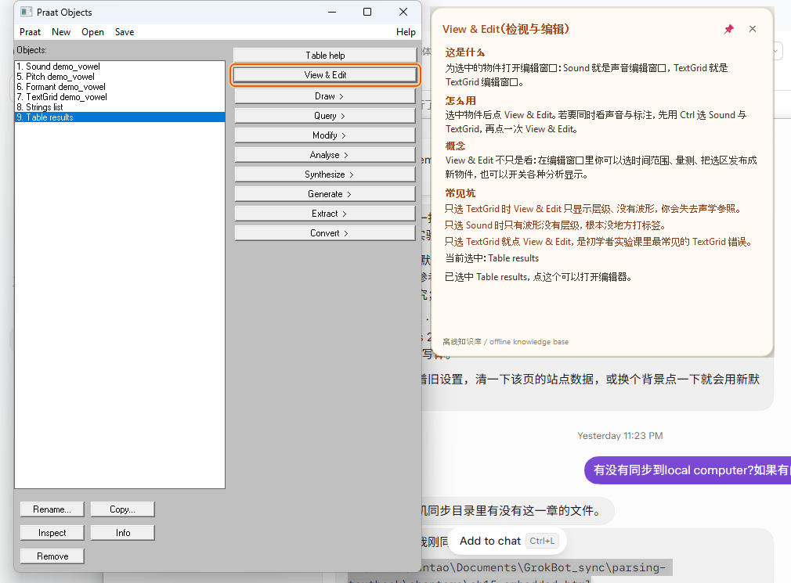
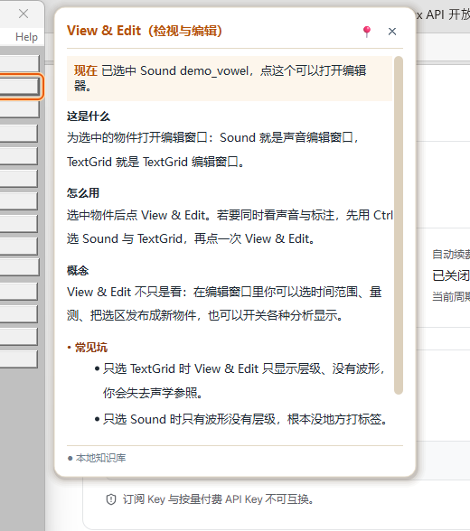
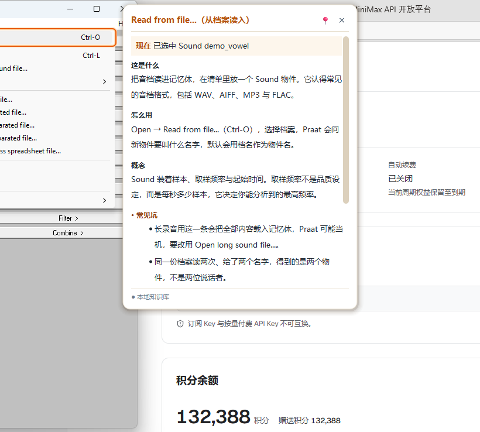
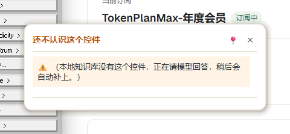
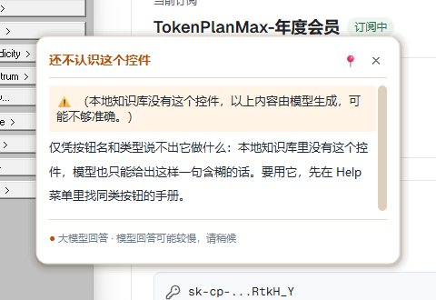
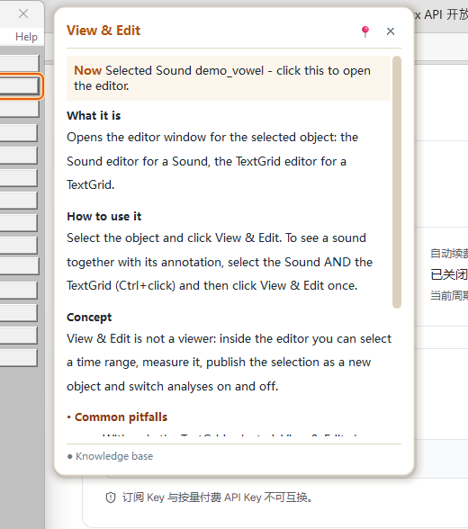

# 16 - 悬浮卡片的设计

> 这份笔记记录 Praatao 悬浮卡片（hover card）重做之前的样子、问题在哪里、
> 参考了哪些成熟工具的做法，以及这次改了什么、为什么这么改。
>
> 读者：以后要改这张卡片的人。相关代码：`praatao/ui/qt/hover.py`（Qt 版）、
> `praatao/ui/hover.py`（Tk 备用版）、`tests/test_card_design.py`。

---

## 1. 改之前的样子



旧的卡片是米黄色的圆角纸片，橙色标题，正文 12px，左边一列橙色小标题
（这是什么 / 怎么用 / 概念 / 常见坑），右下角一行灰色小字说明来源。

它不是不能用。它只是**不像一张给人看懂的卡片**，更像把一段纯文本贴进
了一个框里。

---

## 2. 问题在哪里

### 2.1 没有层级，所有东西都在抢注意力

标题「View & Edit」是橙色粗体，四个小标题也是橙色粗体，正文是黑色，
「常见坑」的整段文字是红棕色。一张卡片里出现了三种颜色、两种字重，
结果是谁都不突出：学生第一眼不知道该看哪一行。

对照成熟工具的做法：VS Code 与 IntelliJ 的悬浮卡只有一个标题是加粗的，
其余全部是正文，靠**字重**和**位置**分层次，不用颜色分层次。

### 2.2 「常见坑」是一堵墙

这一块问题最大。旧卡片把「常见坑」后面的每个陷阱排成一行，每行以
「•」开头，然后**整段涂成红棕色**。三行以上的陷阱连在一起，读起来就是
一堵橙色的墙：学生看不出哪一条跟他有关，也不敢快速扫读。

参考做法：Raycast、Spotlight、Copilot 的做法一致，一条想法一行，
标签用粗体，条目本身用正文的颜色，列表靠**项目符号和缩进**建立结构，
而不是靠颜色。

### 2.3 缺少「为什么现在要看这个」

旧卡片回答的是「这是什么按钮」，没有回答「我现在为什么需要知道它」。
其实知识库里是有这个信息的：导师会把「已选中 Sound demo_vowel，
点这个可以打开编辑器」这样的现场信息放在正文末尾，但它混在最后一段，
字号一样，颜色一样，学生几乎不会注意到。

初学者最容易卡住的地方，恰恰是「这个东西现在跟我有什么关系」。

### 2.4 中文排版没有当成中文排

- **没有指定字体**：沿用系统默认（Segoe UI），中文靠系统的回退字体顶上去，
  同一张卡里拉丁字母和汉字的字面大小对不齐。
- **行高没有设置**：12px 字挤在一起，中文是方块字，字与字之间没有呼吸。
- **每行太长**：卡片正文宽 408px，12px 中文一行能塞 34 个字，
  一行 34 个汉字已经接近中文排版的舒适上限（一般不超过 40 字，
  但报纸正文只有 20 到 30 字）。

### 2.5 卡片偏大，位置也不够稳

旧卡片固定 440px 宽，撑满内容时可以长到 520px 高，在 1080p 的屏幕上
超过半个屏高，已经像一块侧面板而不像一张卡片。卡片出现的位置由
`clamp_rect` 决定，理论上放在控件旁边，但没有任何检查保证它真的
没有压住那个控件。

### 2.6 页脚说不清来源，也不说模型会慢

页脚只有一行灰色小字「离线知识库 / offline knowledge base」。
两个问题：一是中英混排读起来像机器翻译；二是当答案来自大模型时，
页脚写的还是「可能不准确」，而学生真正需要知道的是**「这句话是后来
才到的，等一下」**。模型调用要几秒到几十秒，卡片先给一句话、稍后
再补上，这个设计本身是好的，但页脚没有把这件事说清楚。

---

## 3. 成熟工具怎么做

下面这些做法来自 VS Code / IntelliJ 的悬浮卡、macOS 与 Windows 的
系统提示、Raycast / Spotlight / Copilot 的卡片，以及中文排版的通用
经验。

| 做法 | 谁这么做 | 我们抄了什么 |
|------|-----------|--------------|
| 标题只有一行，是全卡唯一的重字 | VS Code、IntelliJ | 标题 14px 半粗，橙色；其余全部正文色 |
| 正文是一段短话，不是清单 | VS Code、IntelliJ | 「这是什么」只放一句话 |
| 关键事实是紧凑的列表，用粗体标签而不是小标题 | VS Code、Raycast、Copilot | 小标题 12px 半粗，正文色（不再用颜色分层次） |
| 卡片小，出现在指针附近，永不盖住被解释的对象 | 系统提示、VS Code | 固定 400px 宽，卡片永远在控件旁边，并有兜底检查 |
| 软边框、真实阴影、圆角 | 系统提示、Raycast | 12px 圆角，5 层叠出来的柔和阴影，1px 浅边框；阴影留白 12px，比卡片与控件之间 16px 的间距还小，所以卡片窗口也不会压到那个控件 |
| 一行一个想法，短句，可扫读 | Raycast、Copilot | 「常见坑」用真正的项目符号列表，每条一行 |
| 底部有一条页脚，说明来源与下一步 | VS Code、Raycast | 页脚：来源 + 模型时提示「可能较慢」 |
| 中文字体栈、行高 1.5 到 1.7、每行不超过约 40 字 | 中文排版经验 | 微软雅黑优先的字体栈，行高 1.56，一行约 28 个汉字 |

---

## 4. 这次做了什么

### 4.1 卡片结构

卡片从上到下固定为六层，每层只做一件事：

```
标题        这是什么控件（橙色，14px）
──────────────────────────────  一条细线
现在        现场信息：已选中 Sound demo_vowel，点这个可以打开编辑器
这是什么    一句话：这个按钮做什么
怎么用      在这个窗口里怎么用它
概念        背后的声学或语音学想法
常见坑      一条一行，可扫读
──────────────────────────────  一条细线
页脚        来源：本地知识库 / 大模型回答（可能较慢）
```

- **「现在」这一层是新增的**：它由导师正文里最后那一段现场信息变成，
  放在标题下面第一眼的位置，浅米色底色，前面用橙色粗体标一个「现在」
  （正文里是一个小表格，Qt 的富文本只给表格内边距，这是唯一能做出
  带内边距的色块的办法）。
- **「常见坑」变成真正的列表**：`<ul>` 加 `<li>`，Qt 会自己画项目符号并
  做悬挂缩进，条目用正文色，只有小标题用警示色。文字不再整段涂红。
- **系统提示单独一层**：按钮是灰的、正在问模型这类括号里的句子，
  放在最上面，浅橙底色加 ⚠ 标记。

### 4.2 中文排版

- 字体栈：微软雅黑 UI、微软雅黑、PingFang SC、Hiragino Sans GB、
  Noto Sans CJK SC、思源黑体、Segoe UI。Qt 用 `QFont.setFamilies`
  设置整张卡片，HTML 里也写同一套，二者一致。
- 正文字号 13px，行高 1.56（中文方块字需要 1.5 到 1.7）。
- 正文列宽 372px，一行约 28 个汉字，落在报纸正文的舒适区间。
- 小标题 12px、行高 1.35，标题 14px，页脚 11px。

### 4.3 颜色

卡片改用侧栏与设置窗口同一套颜色，不再是独一份的米黄加橙：

| 用途 | 颜色 | 和谁一致 |
|------|------|---------|
| 卡片底 | `#FFFFFF` | 设置窗口 |
| 正文 | `#1F2933` | 侧栏、设置窗口 |
| 次要文字 | `#6B7A89` | 侧栏 |
| 强调色（标题） | `#B4530A` | 侧栏 |
| 「现在」底色 | `#FDF6EC` | 侧栏的浅色块 |
| 边框、细线 | `#E3D9C6` | 侧栏 |
| 警示底色 / 警示字 | `#FFF4E5` / `#8A3B12` | 侧栏 |

### 4.4 位置：卡片永远不压住控件

卡片放在控件旁边，间距 16px；屏幕右边放不下就翻到左边。翻完再检查
一次：如果卡片矩形和控件矩形仍然相交，就把卡片移到控件下方；下方
也放不下才保持原样。菜单项同理，所以卡片不会盖住菜单里其它条目。

### 4.5 页脚：来源与「模型会慢」

| 来源 | 中文页脚 | 英文页脚 |
|------|---------|---------|
| 知识库 | ● 本地知识库 | ● Knowledge base |
| 大模型 | ● 大模型回答 · 模型回答可能较慢，请稍候 | ● Model answer · a model answer can take a while |
| 两者 | ● 知识库 + 大模型 · 模型那部分可能较慢 | ● Knowledge base + model · the model part can take a while |

圆点的颜色也跟着变：知识库是灰的（安静、可信），大模型是橙色
（提醒你这句话还在路上）。

### 4.6 性能：卡片不能让人觉得慢

旧的 `show()` 里有四次 `processEvents()`（每次都把事件队列排空），
加上一次强制重绘。新的做法是：

- 文本先量好再画：`QTextDocument.setTextWidth()` 让文档自己算出高度，
  卡片按这个高度定尺寸，**不需要把窗口显示出来再回缩**；
- 阴影只画一次：阴影是一叠圆角矩形，渲染到一张位图里缓存，
  之后每次重绘只是一次贴图；
- 尺寸不变就不重新布局：只有真的变了才 `setFixedHeight`。

同一台机器、同一段文字、各 30 次渲染：

| | 中位数 | p95 | 第一次显示（含建窗口） |
|---|---|---|---|
| 改之前 | 7.1 到 10.0 ms | 8.5 到 12.3 ms | 28 到 207 ms |
| 改之后 | 1.7 到 4.0 ms | 2.4 到 5.1 ms | 12 到 35 ms |

改之后的中位数在 4 ms 以内，p95 在 10 ms 以内，比旧版快约 2.5 倍。
`tests/test_card_design.py` 里有一条测试守着这个上限。

### 4.7 内容变了也不跳

- 文字列宽固定，内容再长也不会换行重排。
- 迟到的模型答案来了以后，卡片从标题往下长高，**顶边不动**，
  学生不用追着文字跑；只有在底边要掉出屏幕时才把卡片往上挪。
- 卡片高度有上限（520px），超出的部分在卡内滚动，
  滚动条做得又细又淡。

### 4.8 Tk 备用实现同步跟上

`praatao/ui/hover.py`（Tk 版）用同一套解析、同一套颜色、同一套顺序：
同样的「现在」条（浅色底加橙色粗体标签）、同样的粗体小标题、同样的
项目符号列表、同样的页脚。两个实现共用同一份 body 解析规则，
`tests/test_card_design.py` 会检查两边对同一段文字的理解完全一致。

---

## 5. 改之后的样子











---

## 6. 数字一览

| 项目 | 改之前 | 改之后 |
|------|--------|--------|
| 卡片宽度 | 440px（随内容变） | 固定 400px |
| 卡片最大高度 | 520px | 520px |
| 正文字号 / 行高 | 12px / 无 | 13px / 1.56 |
| 每行汉字数 | 约 34 | 约 28 |
| 层次 | 颜色三种、字重两种 | 一个标题、四个粗体小标题、正文一种颜色 |
| 常见坑 | 整段红棕色的文字墙 | 项目符号列表，一条一行 |
| 现场信息 | 混在正文最后 | 标题下的「现在」条 |
| 页脚 | 中英混排一句话 | 来源 + 模型时提示较慢 |
| 渲染中位数 | 7.1 到 10.0 ms | 1.7 到 4.0 ms |
